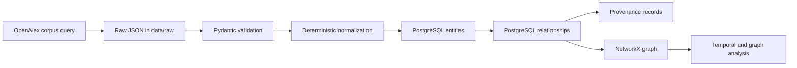

# Phase 1 Architecture

## Scope

Phase 1 builds a small, explainable temporal research knowledge graph for Knowledge Graphs, Temporal Knowledge Graphs, and Scholarly Knowledge Graphs. PostgreSQL is the source of truth. NetworkX is rebuilt from PostgreSQL for analysis.

## Pipeline

## Schema Decisions

- Papers, researchers, institutions, topics, methods, datasets, technologies, and claims are separate tables with stable identifiers and unique constraints.
- `external_id` is preferred for idempotency. Deterministic normalized names are used where external IDs are unavailable.
- Citations are modeled as event relationships. Their time comes from the citing paper publication date/year.
- Affiliations are modeled as temporally valid relationships with `valid_from`, `valid_to`, and `observed_at`.
- Paper-to-topic/method/dataset/technology relationships are observed metadata relationships. They keep provenance but do not pretend to have independent validity intervals.
- Claims are supported structurally, but automatic claim extraction is intentionally out of scope for Phase 1.

## Provenance

Each important relationship may point to `provenance`, which stores source type, source identifier, URL, evidence text when appropriate, extraction method, confidence, and observation time. Confidence is an internal heuristic, not a calibrated truth score.

## Assumptions

- OpenAlex concepts are acceptable as Phase 1 topics.
- Methods and datasets are extracted deterministically from titles/abstracts using small transparent vocabularies. These records are marked with abstract metadata provenance and heuristic confidence.
- OpenAlex referenced works are stored as citations only when the cited paper is already present in the local corpus. This avoids fabricating partial paper records.
- Disappearing relationships mean "not observed in the latest corpus period," not "false."
