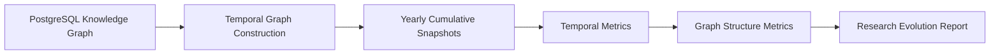

# Phase 2 Temporal Knowledge Analysis

Phase 2 turns the PostgreSQL knowledge graph into time-sliced NetworkX graphs and structured temporal research-evolution reports.

## Pipeline



## Snapshot Semantics

Each yearly graph `G_year` represents knowledge observed in the bounded corpus up to and including that year. Paper-driven relationships are included when the paper publication year is less than or equal to the snapshot year. Valid-time affiliation relationships are included when their validity interval overlaps the snapshot year.

## Implemented Metrics

- Topic activity and growth rates
- Method adoption rates
- Dataset usage trends
- Researcher cohorts: active, new, returning, entering, leaving
- First-observed relationships
- Relationships not observed after the previous snapshot
- Degree centrality
- Betweenness centrality
- Connected components
- Greedy modularity structural communities

## CLI

```bash
python -m src.main evolution --start-year 2021 --end-year 2026
```

The command prints a compact text summary and writes full JSON to `data/evolution_report.json`.

## Caution

The report should be read as corpus-level evidence. "Not observed after year X" does not mean a relationship became false or ceased to exist in the real world.
